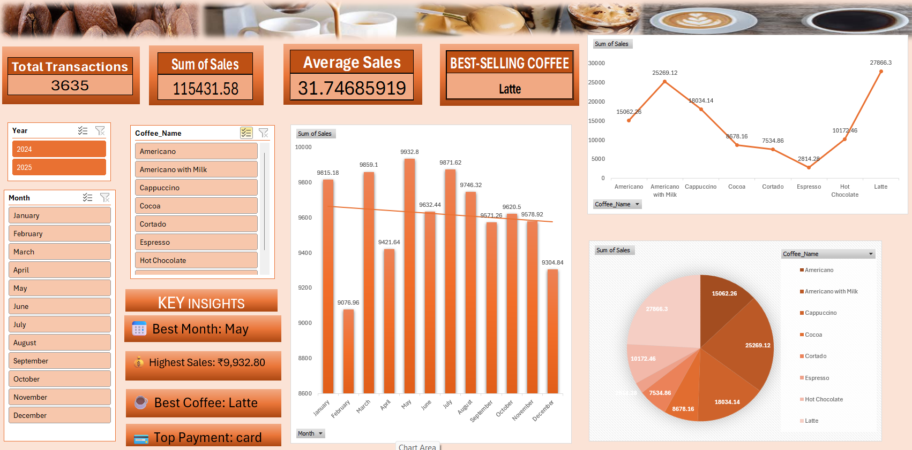
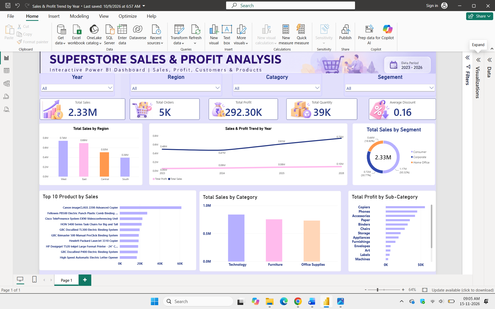

# Hi, I'm Kimaya! 👋

### Aspiring Data Analyst | MBA – Business Analytics

Welcome to my Data Analytics Portfolio!

I am an MBA student with an interest in Data Analytics, MIS Reporting and Business Intelligence. I enjoy working with data, identifying trends and creating meaningful reports to support business decisions.

I am continuously developing my skills through practical projects and hands-on learning.

## 🛠️ Skills & Tools

- **Microsoft Excel:** Data Cleaning, Pivot Tables, Formulas, Charts and Dashboards
- **SQL:** Queries, Filtering, Joins, Aggregate Functions and Window Functions
- **Power BI:** Data Visualisation, Reports and Interactive Dashboards
- **Python:** Basics of Python for Data Analysis

## 📊 My Projects

# 1. Coffee Sales Analysis Dashboard

**Tool:** Microsoft Excel

## Project Objective
To analyse coffee sales data and understand sales performance across different coffee categories and months.

## Key Performance Indicators
- Total Transactions: 3,635
- Total Sales: ₹115,431.58
- Average Sales: 31.75

## Dashboard Features
- Interactive Year, Month and Coffee Name slicers
- Monthly Sales Analysis
- Coffee-wise Sales Comparison
- Sales Distribution Analysis
- Key Business Insights

## Skills Demonstrated
- Excel Data Analysis
- Pivot Tables
- Pivot Charts
- Slicers
- Dashboard Design
- Data Visualisation

[View Coffee Sales Project](./Coffee%20Sales.xlsx)

### 2. Sales & Profit Trend by Year – Power BI

**Tool:** Microsoft Power BI

**Project Overview:**

An interactive Superstore Sales and Profit Analysis dashboard created to explore business performance across different years, regions, product categories and customer segments.

**Key Performance Indicators (KPIs):**
- Total Sales: 2.33M
- Total Orders: 5K
- Total Profit: 292.30K
- Total Quantity: 39K
- Average Discount: 0.16

**Dashboard Features:**
- Interactive Year, Region, Category and Segment filters
- Sales Analysis by Region
- Sales and Profit Trends by Year
- Sales Distribution by Customer Segment
- Top 10 Products by Sales
- Sales Analysis by Category
- Profit Analysis by Sub-Category

**Skills Demonstrated:**
- Power BI Dashboard Development
- Data Visualisation
- Business Performance Analysis
- KPI Reporting
- Interactive Filters and Slicers

[View Power BI Project](./Sales%20%26%20Profit%20Trend%20by%20Year.pbix)

  
[View Power BI Project](./Sales%20%26%20Profit%20Trend%20by%20Year.pbix)

### 3. SQL Query Presentation

***Tool:** SQL

**Project Overview:**

A 21-page presentation covering SQL concepts, database fundamentals and practical SQL queries.

**Topics Covered:**
- SQL Introduction and Database Basics
- SQL Commands and Basic Queries
- Filtering, Sorting and Limiting Data
- Aggregate Functions
- GROUP BY and HAVING
- CASE WHEN and SQL Functions
- SQL JOINs and UNION
- Subqueries
- Window Functions
- Practical SQL Queries and Results

**Skills Demonstrated:**
- SQL Query Writing
- Data Filtering and Sorting
- Data Aggregation
- Database Concepts
- Analytical Query Techniques

[View SQL Presentation](./SQL%20Query%20Presentation.pdf)

[View SQL Presentation](./SQL%20Query%20Presentation.pdf)

## 🎯 Career Goal

To grow as a Data Analyst by applying my analytical skills, improving my technical knowledge and working on real-world business problems.

## 🌱 Currently Learning

- Advanced Excel
- SQL
- Power BI
- Python for Data Analysis
- Business Intelligence

---

Thank you for visiting my portfolio!

**Let's connect and learn together.**
